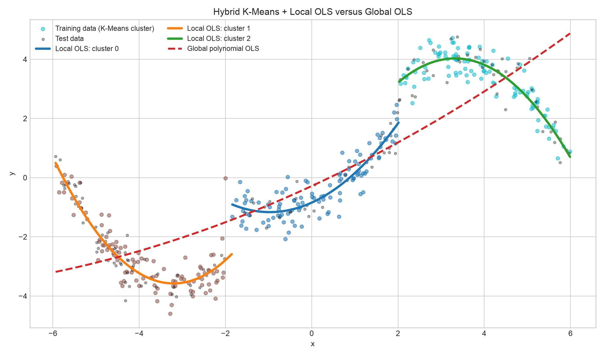

# รายงาน: แบบจำลองถดถอยแบบผสมผสาน K-Means + Local OLS

## วัตถุประสงค์

โครงงานนี้เปรียบเทียบการทำนายข้อมูลที่มีโครงสร้างไม่เป็นเชิงเส้นด้วย 2 แนวทาง

1. **Global Regression**: สร้างสมการพหุนามกำลังสอง OLS เพียงสมการเดียวจากข้อมูลฝึกทั้งหมด
2. **Hybrid K-Means + Local OLS**: จัดกลุ่มตัวแปรอิสระ `x` ด้วย K-Means ก่อน แล้วสร้างสมการพหุนามกำลังสอง OLS แยกหนึ่งสมการต่อกลุ่ม

ชุดข้อมูลเป็นข้อมูลสังเคราะห์ที่ทำซ้ำได้แน่นอน (450 ตัวอย่าง) มีความสัมพันธ์แบบโค้งหลายช่วงและมีสัญญาณรบกวน จึงเหมาะสำหรับสาธิตข้อจำกัดของสมการเดียวทั้งช่วงข้อมูล

## วิธีดำเนินงาน

แบ่งข้อมูลเป็น train 70% และ test 30% โดยตรึง `random_state=42` ไว้เพื่อให้ได้ผลเดิมทุกครั้ง จากนั้นทำงานตามลำดับนี้

```text
ข้อมูลฝึก x, y
     │
     ├─ K-Means (k=3) ใช้ x เท่านั้น ──> ป้ายกลุ่ม c
     │                                  │
     │                                  └─ OLS พหุนามกำลัง 2 ของแต่ละกลุ่ม
     │
     └─ OLS พหุนามกำลัง 2 ของข้อมูลทั้งหมด (baseline)

x ใหม่ ──> K-Means ทำนายกลุ่ม ──> ใช้ Local OLS ของกลุ่มนั้น ──> ŷ
```

แบบจำลองย่อยแต่ละกลุ่มอยู่ในรูป

`ŷ_c = β0,c + β1,c x + β2,c x²`

K-Means ในตัวอย่างนี้ใช้ **x เท่านั้น** ไม่ใช้ `y` ขณะจัดกลุ่ม จึงไม่มีการรั่วไหลของคำตอบ (target leakage) เมื่อทำนายข้อมูลใหม่ ในงานจริงสามารถขยาย `x` เป็นหลายตัวแปรได้ โดยปรับมาตราส่วน (StandardScaler) ก่อน K-Means หากหน่วยของตัวแปรต่างกันมาก

## วิธีรัน

จากโฟลเดอร์นี้ ให้ติดตั้งไลบรารีและรันคำสั่งต่อไปนี้

```bash
python3 -m pip install -r requirements.txt
python3 hybrid_kmeans_ols.py
```

โปรแกรมสร้างไฟล์ใน `outputs/`:

- `comparison_plot.png` — จุดข้อมูล เส้น Local OLS และเส้น Global OLS
- `metrics.csv` — MSE, RMSE และ R² ของชุดทดสอบ
- `local_coefficients.csv` — ค่าสัมประสิทธิ์ของสมการย่อย
- `dataset.csv` และ `results.json` — ข้อมูลและผลลัพธ์ฉบับเต็ม

## ผลการทดลองที่รันได้จริง

การทดสอบบนชุด test 135 ตัวอย่างให้ผลดังนี้

| วิธี | MSE ↓ | RMSE ↓ | R² ↑ |
|---|---:|---:|---:|
| Hybrid K-Means + Local OLS | **0.1847** | **0.4298** | **0.9739** |
| Global polynomial OLS | 2.5298 | 1.5905 | 0.6429 |

Hybrid ลด MSE จาก Global ได้ **92.70%** ในตัวอย่างนี้ แสดงว่าสมการเฉพาะบริเวณอธิบายรูปทรงโค้งหลายช่วงได้ดีกว่าสมการเดียว

สัมประสิทธิ์ Local OLS ที่ได้ (เรียงจากศูนย์กลางกลุ่มทางซ้ายไปขวา) คือ

| กลุ่ม | ศูนย์กลาง x | จำนวน train | สมการประมาณ |
|---:|---:|---:|---|
| 1 | -3.8389 | 102 | `ŷ = 2.0085 + 3.4896x + 0.5451x²` |
| 0 | 0.1380 | 106 | `ŷ = -0.8457 + 0.6594x + 0.3395x²` |
| 2 | 3.9136 | 107 | `ŷ = -1.1371 + 3.1088x - 0.4678x²` |

Global OLS ได้ `ŷ = -0.2857 + 0.6741x + 0.0312x²` ซึ่งจำเป็นต้องเฉลี่ยพฤติกรรมที่ต่างกันของทุกช่วงไว้ในสมการเดียว



## ข้อดี ข้อจำกัด และเงื่อนไขการนำไปใช้

| ประเด็น | Hybrid K-Means + Local OLS | Global OLS |
|---|---|---|
| ความสัมพันธ์หลายรูปแบบ | ดี: ให้สมการปรับตามแต่ละบริเวณ | อาจ underfit เมื่อรูปทรงเปลี่ยนตามช่วง |
| การตีความ | อธิบายได้ในระดับกลุ่ม แต่ต้องอธิบายกฎการแบ่งกลุ่มเพิ่ม | ง่ายที่สุด เพราะมีสมการเดียว |
| ข้อมูลที่ต้องใช้ | ต้องมีตัวอย่างเพียงพอทุกกลุ่ม | ใช้ข้อมูลรวมได้ทั้งหมด |
| ความต่อเนื่องที่รอยต่อ | อาจมีเส้นกระโดดเมื่อเปลี่ยนกลุ่ม | ต่อเนื่องตามรูปแบบสมการ |
| ความเสี่ยง overfitting | เพิ่มตามจำนวนกลุ่มและดีกรีพหุนาม | น้อยกว่า แต่มีความเสี่ยง underfitting |

ควรใช้ Hybrid เมื่อข้อมูลมี regime/segment ตามธรรมชาติ เช่น ยอดขายคนละฤดูกาล, เซนเซอร์หลายสภาวะ, ราคาตามย่านตลาด หรือกระบวนการผลิตหลายโหมด และมีข้อมูลพอในทุกกลุ่ม ควรเลือก `k` และดีกรีพหุนามด้วย cross-validation (พร้อมดู silhouette score หรือค่า validation MSE) ไม่ควรตั้งจากผล test เพียงครั้งเดียว

ควรใช้ Global OLS เมื่อความสัมพันธ์โดยรวมเรียบและไม่ซับซ้อน, ปริมาณข้อมูลน้อย, ต้องการสมการเดียวที่สื่อสารง่าย หรือจำเป็นต้องให้เส้นต่อเนื่องทั่วทั้งโดเมน

## การนำข้อมูลจริงมาใช้

แทนที่ฟังก์ชัน `make_dataset()` ด้วยการอ่าน CSV เช่น `pd.read_csv("your_data.csv")` โดยให้มีคอลัมน์ตัวแปรอิสระและคอลัมน์เป้าหมาย สำหรับข้อมูลหลายตัวแปร ให้ส่งทุกคอลัมน์ตัวแปรเข้า K-Means และ PolynomialFeatures แต่ต้องวางขั้นตอน scaling, การจัดการค่าว่าง และการแบ่ง train/test ก่อน fit เสมอ
